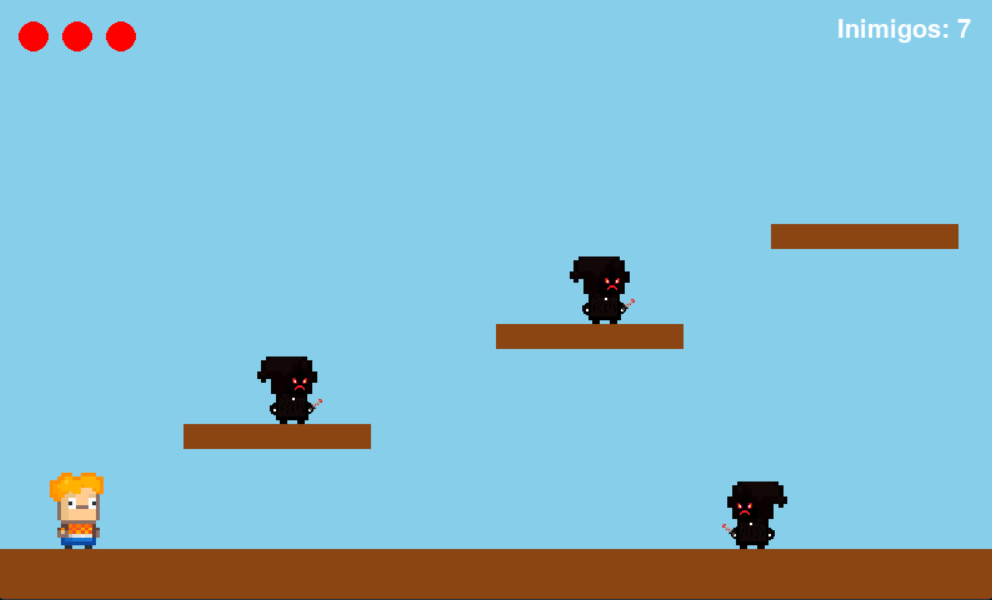
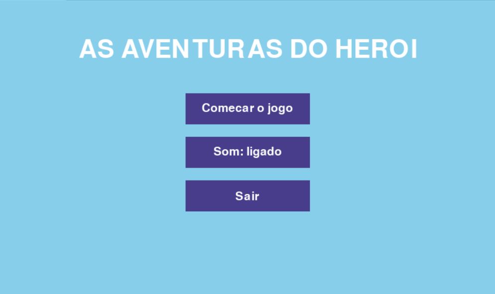

<div align="center">

# As Aventuras do Herói

**Jogo de plataforma 2D feito em Python com Pygame Zero**




</div>

---

## 📖 Sobre o projeto

O herói está cercado de inimigos e a missão é simples: **derrotar todos eles para vencer a fase**. O jogo tem menu inicial, fase com rolagem lateral (câmera que acompanha o herói), sistema de vidas, animações de sprites, música de fundo e efeitos sonoros.

O projeto foi pensado para praticar lógica de jogos em Python: máquina de estados, colisões, física de pulo, câmera e organização do código com classes.

## 🖼️ Capturas de tela

| Menu inicial | Gameplay |
| :---: | :---: |
|  |  |

## ✨ Funcionalidades

- **Menu inicial** com botões para começar, ligar/desligar o som e sair.
- **Fase com rolagem lateral:** o cenário tem 2400 px de largura e a câmera segue o herói.
- **Herói animado:** sprites de parado (idle) e de caminhada, com espelhamento conforme a direção.
- **7 inimigos** que patrulham plataformas e o chão dentro de limites definidos.
- **Combate por pulo:** pular em cima de um inimigo o derrota e faz o herói quicar.
- **Sistema de vidas:** 3 vidas, com período de invulnerabilidade e efeito de piscar após levar dano.
- **Queda no buraco:** cair da plataforma custa uma vida e devolve o herói ao início.
- **Telas de vitória e de Game Over**, com opção de jogar de novo ou voltar ao menu.
- **Áudio:** música de fundo, som de pulo e som de derrota dos inimigos.

## 🕹️ Como jogar

**Objetivo:** derrote os 7 inimigos para ver a mensagem **"VOCE VENCEU!"**.

| Ação | Teclas |
| --- | --- |
| Mover para a esquerda | `A` ou `←` |
| Mover para a direita | `D` ou `→` |
| Pular | `W`, `↑` ou `Espaço` |
| Voltar ao menu | `Esc` |

Os menus também podem ser usados com o **mouse** (clique nos botões).

**Regras:**

- Pule **sobre** um inimigo para derrotá-lo.
- Encostar em um inimigo pela lateral tira **1 vida**.
- O herói começa com **3 vidas**. Ao perder todas, aparece o **Game Over**.
- Depois de vencer ou perder, é possível reiniciar a partida ou voltar ao menu.

## 🛠️ Tecnologias

| Tecnologia | Uso no projeto |
| --- | --- |
| **Python 3** | Linguagem do jogo |
| **Pygame Zero (`pgzrun`)** | Janela, loop do jogo, desenho, teclado, mouse e áudio |
| **Pygame `Rect`** | Áreas de colisão e plataformas |
| **PNG** | Sprites do herói e dos inimigos |
| **MP3 / OGG / WAV** | Música de fundo e efeitos sonoros |
| **Git e GitHub** | Versionamento, com commits no padrão `feat` / `fix` / `refactor` |

## 🚀 Como executar

**Pré-requisito:** [Python 3](https://www.python.org/downloads/) instalado.

**1. Clone o repositório**

```bash
git clone https://github.com/Moises-Assuncao/jogo-kodland.git
cd jogo-kodland
```

**2. Instale o Pygame Zero**

```bash
# Windows
py -m pip install pgzero

# Linux / macOS
python3 -m pip install pgzero
```

**3. Inicie o jogo**

```bash
# Windows
py main.py

# Linux / macOS
python3 main.py
```

> Também é possível iniciar com `pgzrun main.py`, se o comando estiver disponível no seu terminal.

## 📁 Estrutura do projeto

```text
jogo-kodland/
├── main.py        # Código do jogo (estados, herói, inimigos, câmera e telas)
├── images/        # Sprites do herói e dos inimigos (+ versões espelhadas) e prints
├── music/         # Música de fundo (background.mp3)
├── sounds/        # Efeitos sonoros (jump.ogg, enemy_die.wav)
├── README.md
└── LICENSE
```

> Ao adicionar ou trocar imagens e sons, mantenha os nomes usados no código. O Pygame Zero carrega os arquivos pelo nome, sem a extensão.

## 🧠 Como o código está organizado

| Elemento | Responsabilidade |
| --- | --- |
| `AnimatedSprite` | Alterna os quadros de uma animação com base no tempo (`dt`) e devolve a versão espelhada (`_left`) quando necessário |
| `Hero` | Movimento, pulo com gravidade, colisão com plataformas, vidas, invulnerabilidade e detecção do pulo sobre o inimigo |
| `Enemy` | Patrulha entre dois limites, inverte a direção ao chegar neles e anima o sprite |
| `game_state` | Máquina de estados: `menu`, `playing`, `game_over` e `victory` |
| `update_camera()` | Centraliza a câmera no herói, respeitando os limites da fase |
| `update()` / `draw()` | Loop principal do Pygame Zero: lógica e renderização de cada estado |

**Destaques técnicos:**

- Detecção de pulo sobre o inimigo comparando a posição anterior do herói (`prev_bottom`) com o topo do inimigo.
- Plataformas que o herói só atravessa por baixo, pousando apenas quando vem de cima.
- Animações controladas pelo tempo (`dt`), independentes da taxa de quadros.
- Reinício limpo da partida, recriando os inimigos e restaurando o estado do herói.


## 📄 Licença

Distribuído sob a licença **MIT**. Veja o arquivo [`LICENSE`](LICENSE) para mais detalhes.

## 👤 Autor

**Moises Assunção** — [@Moises-Assuncao](https://github.com/Moises-Assuncao)

